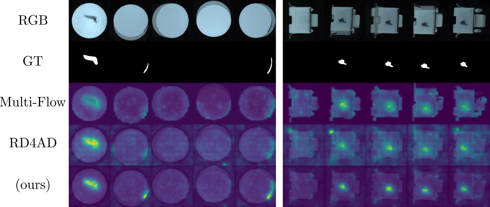
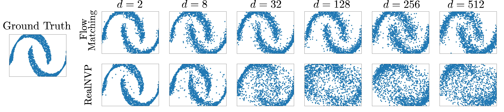

# MATCH: Flow Matching for Multi-View Anomaly Detection
[](https://arxiv.org/abs/2606.24375) [](https://paperswithcode.co/api/v1/papers/2606.24375/leaderboard-badge-link?eval=36399)

This is the official repository to the paper "MATCH: Flow Matching for Multi-View Anomaly Detection"
by Mathis Kruse, Melissa Schween, and Bodo Rosenhahn which was accepted to ECCV 2026!





## Abstract
>Detecting anomalies in industrial objects is an important topic for increasing production efficiency. More complex objects often require the analysis of several view points, which has led to the field of multi-view anomaly detection. We present MATCH, the first multi-view anomaly detection method based on Flow Matching (FM). With the ODE formulation of Flow Matching, we can estimate likelihoods and thereby derive an anomaly score to detect anomalies in multi-view image data at object, image, and pixel-level. The architectural flexibility of FM models allows us to efficiently transform features of different spatial sizes to the normal distribution. We evaluate thoroughly on the already established Real-IAD data set and are also the first to provide a comprehensive evaluation of popular anomaly detection methods for the MANTA-Tiny data set. MATCH achieves state-of-the-art performance in both anomaly detection and segmentation, all while running on consumer-level hardware. By omitting the costly divergence term needed for likelihood estimation, we ensure that MATCH is usable in real-time production scenarios. Lastly, several ablation studies are conducted to validate the methodological choices.




## Installation Setup
To reproduce our results, please clone this repository. We recommend creating a new conda environment and installing all necessary modules. This code has been written and tested on a Linux machine running openSUSE.
```shell
# (1) Cloning the repository
git clone git@github.com:m-kruse98/MATCH.git
cd MATCH

# (2) Create the conda environment
conda create -n match python=3.10
conda activate match

# (3) Install PyTorch. We used version 2.6.0. Newer ones may also work
pip install torch==2.6.0 torchvision==0.21.0 torchaudio==2.6.0

# (4) Install all other necessary packages
pip install -r requirements.txt
```
## Data Set Download & Preparation

The Real-IAD data set can be downloaded [via HuggingFace](https://huggingface.co/datasets/Real-IAD/Real-IAD). We used the 1024-resolution version, but practically, 256 should suffice.

The resulting Real-IAD data set directory is expected to point to two subdirectories:
1. ```jsons/realiad_jsons/``` that contains class-specific .json-files 
2. ```classes/``` that contains the class directories

Both MANTA and MANTA-Tiny can be downloaded [via their own project page](https://grainnet.github.io/MANTA).
Since MANTA-style data sets are of a different format than Real-IAD (all multi-view images are saved in the same image file), you have to use ```convert_manta.py``` to create a Real-IAD-style split of MANTA(-Tiny). Do not forget to change paths to your download locations!
```convert_manta.py``` should format the data set to look exactly like Real-IAD, including both jsons and class directories.


## Running the code


First, set the **paths to the anomaly detection data sets**, that you want to use at the bottom of ```train.py```.

Do not forget to first use ```convert_manta.py```, incase you want to use MANTA(-Tiny).


For training on a single **Real-IAD or MANTA** class (e.g. "audiojack" from Real-IAD), simply run
```
python train.py --data_path audiojack --save_model
```
By default, it will train the model for 150 epochs, evaluating after 75 epochs each time, saving the model only after the last epoch.

Similarly, running the a **multi-class** experiment (one model for all classes) can be done by using any class from RealIAD or MANTA.
```
python train.py --data_path audiojack --multiclass
```

Training it on an **MVTec-style** data set also works, by choosing one of its classes, e.g. "hazelnut" (view-conditioning will automatically be omitted):
```
python train.py --data_path hazelnut
```

## Cite this work (ECCV-style bibtex is pending...)

```
@article{kruse2026match,
  title={MATCH: Flow Matching for Multi-View Anomaly Detection},
  author={Kruse, Mathis and Schween, Melissa and Rosenhahn, Bodo},
  journal={arXiv preprint arXiv:2606.24375},
  year={2026}
}
```


## Acknowledgements
This work was supported by the MWK of Lower Saxony within Hybrint (VWZN4219) and LCIS (VWZN4704), the Deutsche Forschungsgemeinschaft (DFG) under Germany’s Excellence Strategy within the Cluster of Excellence PhoenixD (EXC2122) and Quantum Frontiers (EXC2123), the European Union under grant agreement no. 101136006 – XTREME.


## Code Attributions
Large sections of the code are built upon and **heavily modify** the [flow_matching library](https://github.com/facebookresearch/flow_matching/tree/main/examples/image), which is CC BY-NC licensed.


The RD4AD-inspired PyTorch model is taken from the [anomalib library](https://github.com/open-edge-platform/anomalib/tree/main), which is licensed under the Apache-2.0 license.


Lastly, many thanks to the [ADEval](https://github.com/winggan/adeval) tool, for their efficient anomaly detection evaluation routines.

